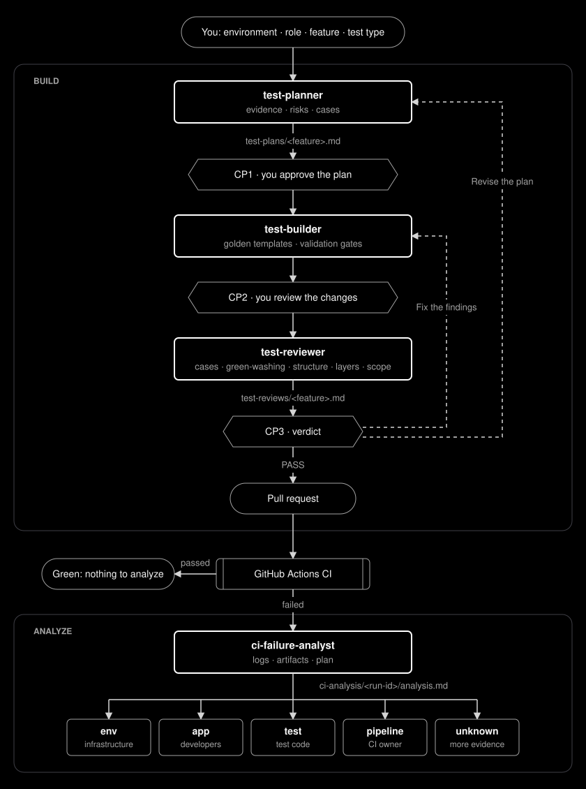

# Playwright Enterprise Test Framework Template

A Playwright + TypeScript test automation template for API, UI, database, accessibility, visual regression, and performance testing. It provides a validated framework core, golden templates that humans and AI tools follow, and quality gates that enforce the architecture.

The template was built and validated against [UPEX DOJO](https://dojo.upexgalaxy.com), which remains the reference implementation for its golden templates ([ADR-007](framework/docs/adr/ADR-007-reusable-template-architecture.md)).

## Quick Start

### Requirements

- **Node.js 22.19 or newer**: check with `node -v`. With nvm: `nvm install 22 && nvm use 22` (the repository ships an `.nvmrc`).
- **npm 11.19.1**: if your npm differs, use `npx npm@11.19.1 ci`.
- **Git**

### Create a project

On macOS or Linux, one script creates a new project next to the template:

```bash
git clone https://github.com/szabihudak/szabihudak-template-SDET-framework.git
cd szabihudak-template-SDET-framework
./install.sh
cd ../<project name>
code .
```

The installer runs in two stages:

| Stage                         | What it does                                                                                                                                           |
| ----------------------------- | ------------------------------------------------------------------------------------------------------------------------------------------------------ |
| **1. Framework setup**        | Asks the setup questions, creates `../<project name>` with its own git, runs `npm ci`, installs the browsers, creates `.env` and runs `npm run doctor` |
| **2. First tests** (optional) | Asks for a test account (username and password, masked), writes it to `.env` as the `user` role and runs `npm run doctor` again                        |

On a terminal it shows both stages as a small flow, marks where the installer stops and your IDE takes over, and ends with the next steps: `cd ../<project name>`, `code .`, starting the MCP servers and configuring login.

### What setup asks

Setup asks only about your application, with menus for every choice (arrow keys, space to select, Enter to confirm):

- project name
- test types and browsers
- environments (staging, local) with their URLs and permissions
- a public OpenAPI (Swagger) URL, when API tests are enabled (optional)
- the test database URL, only when an environment allows database access (masked, written only to `.env`)

It asks nothing about login. You configure the login method afterwards in `config/framework.config.ts`; the project README explains how.

> [!IMPORTANT]
> Use a dedicated test account registered in the application, never a personal or production login. Credentials go only into the git-ignored `.env` and into GitHub secrets, never into prompts or the chat.

Skipped stage 2, or left a field empty? Run `npm run onboard` at any time. Stage 2 never asks anything without a terminal, in CI or with `--answers`; CI takes the credentials from its secrets.

### What the project contains

The template folder stays unchanged, so the next project starts from the same clone.

```text
<project name>/
├── framework/     template-owned: core/ (the framework), templates/, tools/, docs/
├── src/           application layer: schemas, clients, factories, Page Objects, fixtures
├── tests/         specs
├── config/        framework.config.ts, environments, approved-examples.json
├── .github/       CI workflows and AI tool instructions
├── AGENTS.md, README.md, install.sh, .env
└── package.json, playwright.config.ts, tsconfig.json
```

- Setup adds an empty application layer and generic GitHub Actions workflows; it installs no tests.
- It leaves out the UPEX reference implementation, the setup tooling and the workflows of modules you did not enable.
- Without performance tests it also leaves out the Lighthouse runner and its packages (`@lhci/cli`, `lighthouse`, `chrome-launcher`), which make up most of the install size and of the `npm audit` warnings.
- Every project gets `AGENTS.md`, `.github/copilot-instructions.md` (which makes Copilot load it) and `.vscode/mcp.json` with Playwright MCP. The OpenAPI MCP server is added only when the default environment has an OpenAPI URL and `allow.interactiveDiscovery` is enabled.
- Setup installs no AI agents ([ADR-010](framework/docs/adr/ADR-010-agents-outside-the-template.md)); see [AI Tools and Agents](#ai-tools-and-agents).

A teammate who clones the project runs `./install.sh` there: it skips the questions, creates `.env` from `.env.example`, installs the configured browsers and offers stage 2 for their own copy of the test accounts.

### Without the script (Windows)

```bash
npm ci
npm run setup
cd ../<project name>
npm ci
npx playwright install --with-deps
npm run doctor
```

| Option                   | Use                                                                                                                   |
| ------------------------ | --------------------------------------------------------------------------------------------------------------------- |
| `--target <folder>`      | Create the project in another location                                                                                |
| `--in-place`             | Turn the current folder into the project, for a repository created with GitHub's **Use this template**                |
| `--force`                | With `--in-place`: run although there are uncommitted changes                                                         |
| `--answers answers.json` | Non-interactive run (see `framework/setup/selftest/answers-minimal.json`); the database URL comes from `DATABASE_URL` |

### After setup

1. Add the repository variable `TEST_ENV` and the secrets setup lists (`DATABASE_URL` with the database module) under **Settings → Secrets and variables → Actions**. With the database module, setup warns when no environment allows database access or `DATABASE_URL` is empty.
2. Configure login and roles in `config/framework.config.ts`.
3. Add the role accounts to `.env`: `npm run onboard` asks for them.
4. Run `npm run doctor`: it checks that each role logs in.
5. Run `npm run qa:sync-ci-secrets`: it adds the role secrets to the local workflow files and lists the secrets to create in GitHub. It uploads nothing.
6. Write the first tests. CI skips Playwright projects that have no tests yet.

On a terminal the output uses text colors (none with `NO_COLOR`) and a few emoji marks, shown as ASCII (`[x]`, `[-]`, `[!]`, `>>`, `->`, `\m/`) when the locale is not UTF-8.

## What You Get

| Capability             | Where                                                                                                                                                              |
| ---------------------- | ------------------------------------------------------------------------------------------------------------------------------------------------------------------ |
| Framework core         | `framework/core/` (imported as `@framework/...`): environment, config, authentication, fixtures, reporters, schema validation, accessibility, visual, database, AI |
| Your application layer | `src/` (imported as `@app/...`): schemas, API clients, factories, Page Objects, components, mocks, fixtures                                                        |
| Golden templates       | `framework/templates/` catalogued in `framework/templates/index.json` and [README](framework/templates/README.md); VS Code snippets `qa-<id>`                      |
| Configuration          | `config/framework.config.ts`, `config/environments/environments.json`                                                                                              |
| Performance            | k6 under `tests/performance/k6/`, Lighthouse under `framework/core/performance/lighthouse/`                                                                        |
| AI tools               | `AGENTS.md`, `.github/copilot-instructions.md`, `.vscode/mcp.json`; optional agents in [examples/copilot-agents](examples/copilot-agents/README.md)                |
| CI                     | `.github/workflows/`: quality gate, one test job per enabled project (planned from the config, run in the official Playwright image), manual performance workflow  |

## Configuration

`config/framework.config.ts` (validated at load time):

- `modules`: enables Playwright projects (`api`, `ui`, `smoke`, `database`, `accessibility`, `visual`, `performance`).
- `browsers`: browsers for UI and smoke tests.
- `execution`: CI retries and workers.
- `auth.api`: `bearer` token login or `none`.
- `auth.browser`: `nextAuth` credentials session or `none`.
- `roles`: role names mapped to the environment variables holding their test-account credentials. The same credentials provide API bearer tokens (`apiTokenFor(role)` fixture) and browser sessions (`authenticatedPageFor` fixture).
- `requirementsDoc` (optional): HTTP(S) URL or repository-relative path for requirements or acceptance criteria; AI tools use it as the source of expected behavior.
- `uiScenariosDoc` (optional): the same for UI/E2E scenarios (user journeys, UI acceptance criteria); the planner reads it for UI plans.

For API-only testing, enable only the `api` module: setup then skips the browser menu, the web URL is optional and CI runs only the `api` project.

`config/environments/environments.json` defines each target environment:

```json
"staging": {
  "webBaseUrl": "https://staging.example.com",
  "apiBaseUrl": "https://staging.example.com/api",
  "allow": { "database": false, "destructive": false, "performance": true, "interactiveDiscovery": false }
}
```

`webBaseUrl` is required when a browser module (`ui`, `smoke`, `accessibility`, `visual`, `performance`) is enabled, `apiBaseUrl` when `api` or `performance` is; otherwise each may be left out. A test run and `npm run doctor` stop at once when a required URL is missing. `openApiUrl` is always optional.

`TEST_ENV` is required; there is no default target. `allow` controls direct database access, destructive database reset, performance measurement and whether AI discovery may submit non-destructive API/UI interactions. The optional `requirementsDoc` setting in `config/framework.config.ts` points to an HTTP(S) requirements URL or repository-relative document path.

## AI Tools and Agents

The framework works with any AI tool, or none: `AGENTS.md` holds the rules for humans and AI tools, and the checks under [Writing Tests](#writing-tests) and in CI apply to every change, whoever wrote it. Credentials never go into a prompt or the chat; `npm run onboard` puts the test account into `.env` (masked).

Setup installs no agents ([ADR-010](framework/docs/adr/ADR-010-agents-outside-the-template.md)). [examples/copilot-agents](examples/copilot-agents/README.md) has four optional GitHub Copilot agents to copy into a project; the reviewer is described in [ADR-012](framework/docs/adr/ADR-012-test-reviewer-agent.md), the CI failure analyst in [ADR-013](framework/docs/adr/ADR-013-ci-failure-analyst-agent.md):

<p align="center">
  
</p>

Register reviewed tests in `config/approved-examples.json`. From then on they are the first reference for the same responsibility:

```json
{
  "examples": [
    {
      "id": "api-spec",
      "need": "Orders API contract and authorization",
      "file": "tests/api/orders.spec.ts"
    }
  ]
}
```

## Writing Tests

1. Find the golden example: `config/approved-examples.json` (your reviewed examples) first, then `framework/templates/index.json`.
2. Copy the template (or type `qa-<id>` in VS Code), replace the tokens, adapt fields and locators.
3. Validate:

```bash
npx prettier --check .
npm run typecheck
npm run lint:architecture
npm run qa:templates:check
TEST_ENV=staging npx playwright test --project=api
```

Any AI tool follows [AGENTS.md](AGENTS.md) ([AI Tools and Agents](#ai-tools-and-agents)).

## Commands

| Command                        | Purpose                                                                     |
| ------------------------------ | --------------------------------------------------------------------------- |
| `./install.sh`                 | Create a project (template) or install it (project)                         |
| `npm run setup`                | Create a project folder for an application                                  |
| `npm run doctor`               | Check configuration, reachability, credentials and login                    |
| `npm run onboard`              | Stage 2: put the test account into `.env` (optional, rerunnable)            |
| `npm run qa:sync-ci-secrets`   | Add the configured role and database secrets to the workflows               |
| `npm run lint:architecture`    | ESLint architecture rules and test plan format, then plan ↔ spec checks     |
| `npm run qa:templates:check`   | Verify golden templates, catalogue and snippets                             |
| `npm run qa:templates:build`   | Regenerate the catalogue and snippets from `framework/templates/index.json` |
| `npm run qa:templates:extract` | Re-extract templates after an intended canonical change                     |
| `npm run qa:selftest`          | Create projects in temporary folders and verify them                        |
| `npm run db:test:reset`        | Reset the dedicated test database (reference implementation)                |

## Documentation

- [AGENTS.md](AGENTS.md): rules for humans and AI tools, and what to read for each kind of change
- [framework/docs/ARCHITECTURE.md](framework/docs/ARCHITECTURE.md): how the framework is structured and why (for framework and architectural changes)
- [framework/docs/TESTING_STANDARDS.md](framework/docs/TESTING_STANDARDS.md): implementation standards per layer and test type
- [framework/docs/adr/ADR-008-ai-assisted-engineering.md](framework/docs/adr/ADR-008-ai-assisted-engineering.md): how AI agents are used: review first, evidence by source
- [framework/docs/adr/ADR-010-agents-outside-the-template.md](framework/docs/adr/ADR-010-agents-outside-the-template.md): why setup installs no agents, and the optional examples
- [framework/docs/adr/ADR-012-test-reviewer-agent.md](framework/docs/adr/ADR-012-test-reviewer-agent.md): the optional reviewer agent and the lint candidates it found
- [framework/docs/adr/ADR-013-ci-failure-analyst-agent.md](framework/docs/adr/ADR-013-ci-failure-analyst-agent.md): the optional CI failure analyst and why there is no healer agent
- [framework/docs/adr/ADR-011-eslint-architecture-lint.md](framework/docs/adr/ADR-011-eslint-architecture-lint.md): why the architecture lint runs on ESLint and TypeScript stays on 6.0
- [framework/docs/adr/](framework/docs/adr): architecture decisions

## Reference Implementation

The UPEX DOJO implementation in `src/` and `tests/` is the canonical source of the golden templates. The original framework before the template restructuring is preserved on `main` at commit `06e4b5f` (tag `upex-original-v1.0`).
