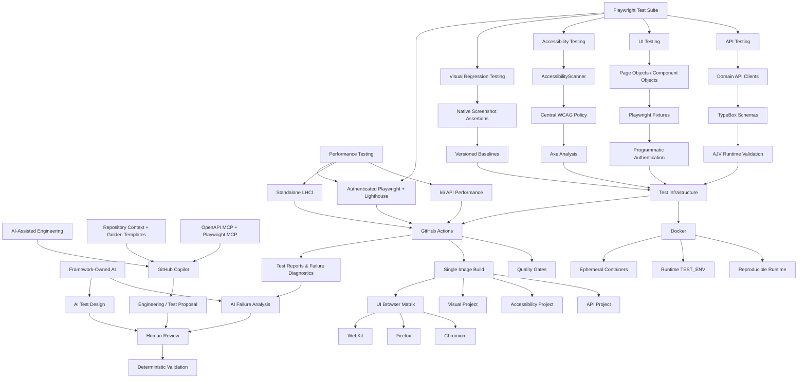

# Playwright Enterprise Framework

[](https://playwright.dev/)
[](https://www.typescriptlang.org/)
[](https://k6.io/)
[](https://github.com/dequelabs/axe-core)
[](https://playwright.dev/docs/test-snapshots)
[](https://www.docker.com/)
[](https://ghcr.io/)
[](https://github.com/szabihudak/playwright-enterprise-framework-private/actions/workflows/playwright.yml)

A production-oriented **Playwright + TypeScript Quality Engineering framework** demonstrating scalable practices across API, database, browser, contract, automated accessibility, visual regression, performance testing, framework-owned AI analysis and test design, and AI-assisted engineering.

The framework is designed around the concerns that matter in real automation systems: **maintainability, reproducibility, execution ownership, runtime contract validation, deterministic test setup, CI efficiency, accessibility quality signals, visual regression signals, performance quality signals, failure diagnostics, structured AI output validation, evidence-grounded AI assistance, and mandatory human review**.

## Engineering Capabilities

| Area                  | Implementation                                                                                                                                        |
| --------------------- | ----------------------------------------------------------------------------------------------------------------------------------------------------- |
| API Testing           | Browser-independent Playwright API tests with domain-specific clients                                                                                 |
| Database Testing      | Typed PostgreSQL persistence validation through domain database clients                                                                               |
| Contract Testing      | TypeBox schemas with AJV runtime validation                                                                                                           |
| UI Automation         | Page Objects, Component Objects, fixtures, and network mocking                                                                                        |
| Accessibility Testing | Axe-based automated WCAG 2.2 AA checks with dedicated Playwright execution                                                                            |
| Visual Regression     | Native Playwright page and component screenshot baseline comparison                                                                                   |
| Performance Testing   | k6 API performance and Lighthouse browser performance with calibrated quality gates                                                                   |
| Authentication        | Programmatic API and browser authentication                                                                                                           |
| Test Data             | Deterministic factories with scenario-specific overrides                                                                                              |
| Cross-Browser         | Chromium, Firefox, and WebKit execution                                                                                                               |
| Containerization      | Reproducible Playwright and UPEX local execution with Docker Compose                                                                                  |
| CI/CD                 | GitHub Actions with immutable test/app images, localDocker functional jobs, and dedicated performance CI                                              |
| Diagnostics           | Playwright diagnostics, k6 HTML reports, and Lighthouse HTML/JSON reports preserved as execution evidence                                             |
| Engineering Standards | Architecture documentation, testing standards, ADRs, repository AI instructions, and Golden Template guidance                                         |
| AI Failure Analysis   | Structured, sanitized Playwright failure evidence analyzed through the OpenAI Responses API with runtime schema validation and mandatory human review |
| AI Test Design        | Structured requirement-to-test-design generation with explicit risks, recommended layers, missing context, and anti-hallucination guardrails          |

## Architecture at a Glance



## Engineering Approach

This repository is intentionally developed as an **automation engineering system rather than a collection of automated tests**.

The framework favors:

- explicit responsibility boundaries;
- reusable but focused abstractions;
- runtime validation instead of trusting compile-time types alone;
- API-driven setup where browser interaction is not the behavior under test;
- deterministic and isolated test data;
- reproducible execution across local and CI environments;
- build-once, configure-at-runtime container execution;
- explicit execution ownership across Playwright testing, k6 API performance, and Lighthouse browser performance;
- actionable diagnostics when execution fails;
- documented architectural decisions and trade-offs.

New capabilities are introduced only when they demonstrate a real testing or architectural requirement.

> **Project status:** Active development. The current foundation includes API/UI automation, database persistence validation, contract validation, programmatic authentication, automated WCAG accessibility testing, native Playwright visual regression testing, k6 API performance testing, Lighthouse browser performance testing, Docker Compose local execution, cross-browser testing, and GitHub Actions CI. Additional Quality Engineering capabilities are introduced incrementally as the framework evolves.

## Quick Navigation

- [Architecture](docs/ARCHITECTURE.md)
- [AI-Assisted QA Workflow](docs/AI_ASSISTED_QA_WORKFLOW.md)
- [Testing Standards](docs/TESTING_STANDARDS.md)
- [Framework Requirements](docs/FRAMEWORK_REQUIREMENTS.md)
- [Architecture Decision Records](docs/adr/)
- [Performance Testing](#performance-testing)
- [Docker Execution](#docker-execution)
- [CI Pipeline](#ci-pipeline)
- [Running Locally](#running-locally)

## Technology Stack

| Area                      | Technology                    |
| ------------------------- | ----------------------------- |
| Test Framework            | Playwright                    |
| Language                  | TypeScript                    |
| API Testing               | Playwright APIRequestContext  |
| Database Testing          | PostgreSQL + pg + Neon        |
| Runtime Schema Validation | TypeBox + AJV                 |
| UI Automation             | Playwright Browser Automation |
| Accessibility Testing     | @axe-core/playwright          |
| Visual Regression         | Playwright Screenshot Testing |
| Performance Testing       | k6 + Lighthouse / LHCI        |
| Containerization          | Docker                        |
| Container Registry        | GitHub Container Registry     |
| CI/CD                     | GitHub Actions                |
| Formatting                | Prettier                      |
| Target Application        | UPEX DOJO                     |
| Framework-Owned AI        | OpenAI Responses API          |
| AI-Assisted Engineering   | GitHub Copilot                |
| External AI Evidence      | OpenAPI MCP + Playwright MCP  |

## Architecture

The framework separates test behavior from reusable infrastructure.

### API flow

```text
Spec
  ↓
Fixture
  ↓
Factory
  ↓
Domain API Client
  ↓
TypeBox Schema
  ├── Static<T> → compile-time type
  └── AJV → runtime validation
  ↓
HTTP assertion
  ↓
Schema validation
  ↓
Business assertions
```

Successful provider responses are validated at runtime before their data is trusted by the test.

### Database flow

```text
Spec
  ↓
Fixture
  ↓
Domain Database Client
  ↓
DatabaseClient
  ↓
PostgreSQL / Neon
  ↓
Business assertions
```

Database tests validate persisted application state through typed domain database clients. SQL remains inside the database client layer, connection lifecycle is fixture-managed, and assertions remain in the spec. Database execution is restricted to the dedicated `localDocker` test environment.

### UI flow

```text
Spec
  ↓
Fixture
  ↓
Page Object / Component Object
  ↓
Playwright Page
  ↓
Application UI
```

API and programmatic setup are used where appropriate to keep UI tests focused on the browser behavior being verified.

### Accessibility flow

```text
Spec
  ↓
Fixture
  ↓
AccessibilityScanner
  ↓
central WCAG policy
  ↓
axe analysis
  ↓
formatted diagnostics
  ↓
accessibility assertion
```

Automated accessibility checks use the framework's central WCAG 2.2 Level AA policy and intentionally fail when configured axe rules report violations.

Automated axe coverage provides a quality signal for supported automated rules; it does not replace manual accessibility testing or prove complete WCAG conformance.

### Visual regression flow

```text
Deterministic test state
  ↓
Page Object / Component locator
  ↓
Native Playwright screenshot assertion
  ↓
Version-controlled approved baseline
  ↓
Visual comparison
```

Visual regression coverage uses native Playwright screenshot assertions for representative page-level and component-level visual contracts.

Approved baselines are generated and reviewed in the canonical Docker/Linux runtime, stored with the visual specs, and version-controlled with the framework. CI compares current rendering against committed baselines and does not automatically update them.

Detailed baseline creation, review, and update rules are defined in [`docs/TESTING_STANDARDS.md`](docs/TESTING_STANDARDS.md).

### Performance flow

Performance coverage separates API workload performance from browser-observed page performance.

```text
API performance
→ k6
→ authenticated API workload
→ workload-specific metrics
→ calibrated thresholds
→ HTML execution evidence

Browser performance
→ Lighthouse
├── standalone LHCI baseline
└── authenticated dashboard audit
    → existing deterministic fixture setup
    → authenticated browser state
    → representative page state
    → Lighthouse metrics
    → shared threshold policy
    → HTML / JSON execution evidence
```

The current k6 baseline measures authenticated task-read behavior with a controlled `2 VU / 30s` workload.

The authenticated Lighthouse baseline reuses the framework's existing deterministic application setup rather than introducing performance-specific business-state initialization. A registered and authenticated user, one deterministic task, and the authenticated dashboard state are established before browser performance is measured.

Authenticated Lighthouse execution performs three independent Lighthouse measurements and evaluates the shared quality policy against the median metric values. This reduces sensitivity to single-run noise while preserving the same threshold and severity semantics used by the standalone LHCI path.

Lighthouse currently evaluates:

```text
Performance score
→ error threshold

Cumulative Layout Shift (CLS)
→ error threshold

Total Blocking Time (TBT)
→ error threshold

Largest Contentful Paint (LCP)
→ warning threshold

Speed Index
→ diagnostic metric
```

Performance thresholds are calibrated from repeated measurements under a controlled representative state when no externally defined SLA, SLO, or approved performance target exists. A single measurement is evidence, not sufficient justification for a new threshold.

For the complete architectural rules, see [`docs/ARCHITECTURE.md`](docs/ARCHITECTURE.md). For baseline calibration and implementation rules, see [`docs/TESTING_STANDARDS.md`](docs/TESTING_STANDARDS.md).

## Repository Structure

```text
config/
  environments/

docs/
  adr/

performance/
  k6/
  lighthouse/


src/
  accessibility/
    constants/
    utils/
  ai/
    analyzers/
    cli/
    generators/
    prompts/
    reporters/
    schemas/
    utils/
  api/
    clients/
    constants/
    models/
    schemas/
    utils/
  database/
    clients/
    utils/
  components/
  data/
  fixtures/
  mocks/
  pages/
  utils/
  visual/
    constants/

tests/
  accessibility/
  ai/
  api/
  database/
  performance/
  smoke/
  ui/
  visual/
    visual.spec.ts-snapshots/

.github/
  workflows/
```

## API Testing

API tests are implemented as browser-independent Playwright tests.

The framework uses a schema-first contract strategy:

```text
HTTP response
    ↓
status assertion
    ↓
parse response
    ↓
runtime schema validation
    ↓
typed business assertions
```

TypeBox schemas provide both compile-time TypeScript types and runtime contracts validated through AJV.

This prevents provider responses from being trusted through TypeScript casting alone.

API clients remain responsible for HTTP interaction, while assertions remain in the test layer.

## Database Testing

Database tests validate persistence across application and database boundaries without leaking SQL or PostgreSQL transport concerns into specs.

The canonical flow is:

```text
API / fixture setup
→ application behavior
→ domain database client
→ persisted PostgreSQL state
→ spec assertions
```

`DatabaseClient` owns PostgreSQL transport and connection lifecycle primitives. `UserDatabaseClient` and `TaskDatabaseClient` own domain-specific SQL and query semantics. Fixtures provide these clients to specs and close the shared pool after execution.

The dedicated `database` Playwright project executes only in `localDocker` and uses `retries: 0` so persistent test state remains clear and duplicate retry-created datasets are avoided. Test factories generate unique data to reduce collisions.

Normal test execution does not automatically delete persisted data. The dedicated Neon database is disposable and test-owned, so state remains available for debugging until an explicit guarded reset is requested.

The reset workflow requires `TEST_ENV=localDocker`, `CONFIRM_DB_RESET=true`, and `DATABASE_URL`, recreates the public schema, restores the UPEX schema through `db:push`, reseeds the application baseline, and verifies that the expected baseline data exists.

## UI Testing

UI automation follows Page Object and Component Object boundaries.

Page Objects represent page-level behavior, while Component Objects encapsulate reusable UI regions.

Authentication setup is separated from the behavior under test. Protected UI scenarios use a programmatically authenticated browser context rather than repeating UI login unless login itself is the scenario being tested.

Locator scope follows the actual application DOM, including support for portal-rendered UI elements.

## Accessibility Testing

Automated accessibility testing uses `@axe-core/playwright` through a reusable `AccessibilityScanner`.

The current framework policy targets automated WCAG 2.2 Level AA coverage through a centralized set of axe rule tags.

Accessibility assertions remain in specs, while diagnostic formatting is separated from pass/fail logic.

Representative golden coverage includes both:

```text
public page
→ standard page context
→ accessibility fixture

authenticated page
→ authenticatedPage context
→ authenticatedAccessibility fixture
```

The dedicated accessibility Playwright project currently executes through Chromium once rather than duplicating the same accessibility suite across the full browser matrix.

Real accessibility violations remain failing quality signals. The framework does not suppress violations or use `continue-on-error` merely to keep CI green.

Automated axe analysis does not replace manual accessibility testing for requirements that cannot be reliably automated.

## Visual Regression Testing

Visual regression testing uses Playwright's native screenshot assertions rather than introducing a separate visual-testing abstraction.

The current golden coverage includes:

```text
authenticated dashboard
→ page-level visual contract

deterministic task card
→ component-level visual contract
```

Visual scenarios use deterministic API-driven setup and existing Page Object or locator ownership before screenshot comparison.

The dedicated `visual` Playwright project currently executes through Chromium in the canonical Docker/Linux runtime. Visual coverage is not duplicated across Firefox and WebKit unless a concrete cross-browser visual risk justifies additional browser-specific baselines.

Approved screenshot baselines are stored alongside the visual specs under Playwright-managed snapshot directories and are committed to Git.

Baseline creation and updates are explicit review operations. CI performs comparison against committed baselines and never automatically approves rendering changes through `--update-snapshots`.

For the complete baseline lifecycle and visual testing rules, see [`docs/TESTING_STANDARDS.md`](docs/TESTING_STANDARDS.md).

## Performance Testing

The framework uses complementary performance-testing boundaries for API workload behavior and browser-observed user experience.

```text
API performance
→ k6

Browser performance
→ Lighthouse / LHCI
```

k6 measures controlled HTTP workload behavior such as latency and failure rate without introducing browser rendering into the measurement.

Lighthouse measures browser-observed page performance, including loading, rendering, main-thread blocking, and layout stability.

The browser performance capability currently provides two execution modes:

```text
standalone LHCI
→ public application baseline
→ repeated Lighthouse collection

authenticated Playwright + Lighthouse
→ existing authenticated fixture chain
→ deterministic task state
→ authenticated dashboard
→ Lighthouse audit
```

The authenticated audit intentionally reuses the same deterministic setup already owned by the functional framework. Performance coverage changes the measurement layer rather than duplicating business-state initialization.

When no authoritative performance target exists, thresholds are calibrated from repeated measurements of a controlled representative state rather than selected from a single run or arbitrary round number.

### API Performance

API performance testing uses k6 through a runtime boundary separate from Playwright.

The current baseline exercises authenticated task reads against the UPEX DOJO API without creating task data during the measured workload.

k6 setup registers and authenticates a performance user, then creates a dedicated task outside the measured workload. The authenticated state is reused during execution.

k6 teardown deletes the dedicated task after the workload completes. The generated performance user remains because the target application does not expose a supported account-deletion endpoint.

Current workload:

```text
executor
→ constant-vus

virtual users
→ 2

duration
→ 30 seconds

pacing
→ 1 second between iterations
```

The workload is deliberately small because the hosted UPEX DOJO environment is shared infrastructure. It is a controlled performance baseline rather than a stress, spike, soak, or capacity test.

Performance quality is evaluated through workload-specific metrics:

```text
task_read_duration
→ p(95) < 500 ms

task_read_failures
→ rate < 1%
```

The thresholds were introduced after repeated baseline calibration rather than being selected as arbitrary SLA values.

Threshold failure produces a non-zero k6 exit code.

The performance run also generates:

```text
performance-results/k6/task-read-load.html
```

as human-readable execution evidence.

### Browser Performance

Browser performance testing uses Lighthouse.

Standalone LHCI provides repeated collection against the configured public application URL.

Authenticated dashboard performance is measured through a dedicated Playwright performance scenario that:

```text
reuses existing fixtures
→ establishes authenticated application state
→ creates one deterministic task
→ confirms the representative dashboard state
→ transfers browser authentication to the Lighthouse browser
→ executes the audit
→ evaluates the shared Lighthouse policy
→ preserves HTML and JSON evidence
```

The Lighthouse threshold policy distinguishes hard `error` quality gates from `warn` signals. Warning-level regressions remain visible without failing the execution, while error-level violations fail the authenticated performance test.

The same threshold values and severities are shared between standalone LHCI and the authenticated Lighthouse execution so both consumers interpret the browser-performance policy consistently.

## Authentication

The target application exposes separate API and browser authentication mechanisms:

```text
API authentication
→ Bearer JWT

Browser authentication
→ Auth.js session
```

The framework preserves this distinction through explicit fixture states:

```text
testUserData
→ generated only

registeredTestUser
→ registered through API

authenticatedTestUser
→ registered + API authenticated

authenticatedPage
→ programmatically authenticated browser context
```

This keeps setup fast while preserving correct authentication boundaries.

## Test Data

Reusable test data is generated through domain factories.

Factories provide valid defaults with explicit overrides:

```text
valid defaults
+
scenario overrides
=
test-specific data
```

Negative tests can intentionally generate partial or invalid payloads when required.

Factories remain independent from HTTP execution, UI interaction, assertions, and fixture lifecycle.

## Docker Execution

Docker provides the canonical reproducible runtime for Playwright functional testing and the local UPEX application while preserving the separate k6 and Lighthouse performance boundaries.

The Playwright test image is built from:

```text
mcr.microsoft.com/playwright:v1.62.1-noble
```

and installs project dependencies reproducibly through:

```text
npm ci
```

Local Docker execution uses Docker Compose with two services:

```text
app
→ UPEX DOJO application
→ http://upex-local:3000
→ dedicated Neon test database

tests
→ reusable Playwright test image
→ TEST_ENV=localDocker
→ reaches UPEX through the Compose service alias
```

The base `docker-compose.yml` defines the runtime contract. `docker-compose.local.yml` adds local build behavior: the framework builds its Playwright image and builds UPEX from the sibling `../upex-dojo` source through `Dockerfile.upex-local`.

PostgreSQL is not started as a local container. The UPEX application and database tests use the dedicated external Neon test database supplied through `DATABASE_URL`.

The framework follows:

```text
build once
→ configure at runtime
```

Target environment selection and credentials are supplied at runtime rather than baked into either image.

### Container Lifecycle

The local application is started through Compose and must become healthy before the test container executes. Test containers remain ephemeral, while the application container can remain available for the duration of the selected local test run.

```text
Compose starts UPEX
→ healthcheck passes
→ Playwright test container starts
→ selected project executes
→ process returns exit code
→ test container is removed
```

The Playwright process exit code represents the test result.

### Docker Artifacts

The base Compose configuration bind-mounts:

```text
playwright-report/
test-results/
```

from the Playwright container to the host so reports and diagnostics survive ephemeral test-container removal.

Local Docker artifact persistence and CI artifact upload are separate concerns. Docker Compose uses bind mounts for local evidence, while GitHub Actions preserves execution evidence through workflow artifacts according to each job's responsibility.

## CI Pipeline

GitHub Actions provides automated quality validation and reproducible functional execution against an ephemeral Dockerized UPEX application.

Current main Playwright CI architecture:

```text
quality
├── Prettier
└── TypeScript typecheck
        ↓
build-images
├── Playwright test image → framework github.sha
└── UPEX app image → resolved upstream UPEX commit SHA
        ↓
        ├── api
        ├── database
        ├── accessibility
        ├── visual
        └── ui matrix
            ├── chromium
            ├── firefox
            └── webkit
```

After quality validation succeeds, CI builds and publishes two immutable GHCR images once: the Playwright test image tagged with the framework commit SHA and the UPEX application image tagged with the resolved upstream UPEX commit SHA.

Each functional job pulls those exact images, starts the UPEX application through the base Compose runtime, waits for the application healthcheck, and executes the selected Playwright project through the `tests` service with `TEST_ENV=localDocker`.

API and database tests execute once because they are browser-independent. Database retries are disabled. Accessibility and visual regression each execute once through their dedicated Chromium-based projects. UI and smoke tests execute through the Chromium, Firefox, and WebKit matrix.

The API, database, accessibility, visual, and UI jobs are independent after `build-images`, so one capability failure does not prevent the others from producing their own quality signals.

Visual CI compares current rendering against committed Docker/Linux baselines without updating them.

Reports and failure diagnostics are bind-mounted from the test container to the runner and preserved through the CI artifact strategy. Application logs are surfaced on test failure for additional diagnostics.

Performance execution remains separate and continues to target the hosted environment through its dedicated workflow.

### Performance CI

Performance execution is owned by the separate:

```text
.github/workflows/performance.yml
```

workflow.

The hosted performance workflow is intentionally triggered through:

```text
workflow_dispatch
```

rather than normal pull-request execution.

Performance CI separates API workload performance from browser performance:

```text
Performance Tests
├── api-performance
│   └── k6
│       → pinned Docker runtime
│       → authenticated API workload
│       → threshold enforcement
│       → HTML execution evidence
│
└── browser-performance
    ├── standalone LHCI
    │   → repeated public-page collection
    │   → shared Lighthouse threshold policy
    │
    └── authenticated Playwright + Lighthouse
        → deterministic existing fixture setup
        → authenticated dashboard state
        → shared Lighthouse threshold policy
        → HTML / JSON execution evidence
```

Both performance paths resolve the selected target through the shared environment configuration while preserving their technology-specific execution boundaries.

The k6 workload executes through the pinned k6 Docker image. Lighthouse execution uses the Node/Chromium environment prepared by the browser-performance job.

API and browser performance results are preserved as separate CI evidence so failures remain attributable to the measurement layer that produced them.

## Playwright Projects

The current project ownership is:

```text
api
→ tests/api/**

database
→ tests/database/**
→ localDocker only
→ retries disabled

accessibility
→ tests/accessibility/**
→ Chromium

visual
→ tests/visual/**
→ Chromium

performance
→ tests/performance/**
→ Chromium
→ authenticated browser-performance scenarios

chromium
firefox
webkit
→ tests/ui/**
→ tests/smoke/**
```

This prevents browser-independent API and database tests from being redundantly executed once per browser, keeps database, automated accessibility, visual regression, and authenticated browser-performance execution explicit and non-duplicated, and preserves cross-browser coverage where browser behavior matters.

The `performance` project owns Playwright-orchestrated browser-performance scenarios such as the authenticated Lighthouse dashboard audit. It establishes application state through existing framework fixtures before handing the prepared browser state to the performance measurement layer.

Standalone LHCI and k6 are not Playwright projects. They retain their own execution boundaries under the dedicated performance workflow.

## Reports and Diagnostics

CI preserves execution evidence through Playwright artifacts.

```text
HTML report
→ uploaded for every test execution

Failure diagnostics
→ uploaded when execution fails
```

Artifacts are separated by execution responsibility and browser so failures remain attributable to the correct job.

Accessibility CI evidence is preserved separately through:

```text
playwright-report-accessibility
test-results-accessibility
```

Visual regression CI evidence is preserved separately through:

```text
playwright-report-visual
test-results-visual
```

Database CI evidence is preserved separately through:

```text
playwright-report-database
test-results-database
```

Playwright is configured to retain additional diagnostics for failed or retried execution, including screenshots, video, and traces according to the configured policy.

Docker-based local execution can preserve the same generated Playwright output directories through bind mounts, independently of CI artifact handling.

Performance CI preserves execution evidence separately for API and browser performance.

k6 produces a human-readable HTML report:

```text
performance-results/k6/task-read-load.html
```

Lighthouse produces browser-performance evidence under:

```text
performance-results/lighthouse/
```

including Lighthouse HTML and JSON reports.

The authenticated Lighthouse scenario also publishes its metrics and evaluated policy result through Playwright test attachments. Warning-level policy violations are retained as test annotations, while error-level violations determine the test outcome.

CI uploads k6, Lighthouse, and Playwright performance evidence separately so API workload failures, browser-performance regressions, and Playwright scenario failures remain diagnosable without conflating their responsibilities.

## Environment Configuration

The framework supports explicit target environments through `TEST_ENV`.

Current environment definitions include:

```text
hosted
local
ci
localDocker
```

Environment URLs are defined in:

```text
config/environments/environments.json
```

The TypeScript environment adapter consumes the same configuration through:

```text
config/environments/environment.ts
```

Local native execution uses:

```text
TEST_ENV=local
→ http://localhost:3000
```

The main Playwright CI and Docker Compose functional execution use:

```text
TEST_ENV=localDocker
→ http://upex-local:3000
→ http://upex-local:3000/api
```

`DATABASE_URL` remains runtime configuration and is not stored in `environments.json`. Database access is guarded so framework database fixtures execute only when `TEST_ENV=localDocker`.

The dedicated performance workflow remains hosted and uses the shared environment configuration for both performance boundaries:

```text
k6 API performance
→ apiBaseUrl
→ supplied to the workload as TARGET_BASE_URL

Lighthouse browser performance
→ webBaseUrl
→ used as the browser audit target
```

The execution environment and test target environment remain separate concepts.

## Running Locally

Install dependencies:

```bash
npm ci
```

Install Playwright browsers:

```bash
npx playwright install
```

For native local execution, start UPEX separately on `localhost:3000`, then select the local target:

```bash
TEST_ENV=local npx playwright test --project=api
```

The same `TEST_ENV=local` target can be used for local browser debugging against the locally running application.

Run formatting validation:

```bash
npx prettier --check .
```

Run TypeScript validation:

```bash
npm run typecheck
```

### Running with Docker Compose

The canonical functional Docker runtime uses the framework-owned base Compose file plus the local build override. The UPEX source is expected in the sibling `../upex-dojo` repository.

Start the local UPEX application:

```bash
docker compose \
  -f docker-compose.yml \
  -f docker-compose.local.yml \
  up -d app
```

Run the API project:

```bash
docker compose \
  -f docker-compose.yml \
  -f docker-compose.local.yml \
  run --rm tests npx playwright test --project=api
```

Run the database project:

```bash
docker compose \
  -f docker-compose.yml \
  -f docker-compose.local.yml \
  run --rm tests npx playwright test --project=database
```

Run accessibility, visual, or a browser project by selecting the corresponding Playwright project through the same `tests` service.

Database-capable localDocker execution requires `DATABASE_URL` to be supplied at runtime. Do not commit the connection string.

### Resetting the Dedicated Test Database

The dedicated Neon test database is not reset automatically after normal test runs. To explicitly restore the application-owned baseline, run the guarded reset with all required safety inputs:

```bash
TEST_ENV=localDocker \
CONFIRM_DB_RESET=true \
DATABASE_URL="<dedicated-test-database-url>" \
npm run db:test:reset
```

The reset recreates the public schema, runs the UPEX-owned `db:push` and `db:seed` commands through Docker Compose, and verifies the seeded baseline before completing. Use this only against the dedicated disposable test database.

### Running k6 API Performance Tests with Docker

Resolve the hosted API URL from the shared environment configuration:

```bash
TARGET_BASE_URL=$(node -e "
  const environments = require('./config/environments/environments.json');
  process.stdout.write(environments.hosted.apiBaseUrl);
")
```

Create the k6 report directory:

```bash
mkdir -p performance-results/k6
```

Run the current performance baseline:

```bash
docker run --rm \
  --user "$(id -u):$(id -g)" \
  -e TARGET_BASE_URL="$TARGET_BASE_URL" \
  -e K6_WEB_DASHBOARD=true \
  -e K6_WEB_DASHBOARD_PORT=-1 \
  -e K6_WEB_DASHBOARD_EXPORT=/reports/task-read-load.html \
  -v "$PWD/performance/k6:/scripts" \
  -v "$PWD/performance-results/k6:/reports" \
  grafana/k6:1.8.1 \
  run /scripts/taskReadLoad.js
```

The HTML report is written to:

```text
performance-results/k6/task-read-load.html
```

## Engineering Standards

The repository contains explicit architecture and implementation standards.

Before making framework changes, contributors should read:

- [`docs/ARCHITECTURE.md`](docs/ARCHITECTURE.md)
- [`docs/TESTING_STANDARDS.md`](docs/TESTING_STANDARDS.md)
- [`AGENTS.md`](AGENTS.md)
- relevant Architecture Decision Records under [`docs/adr/`](docs/adr/)

The framework follows a simple extension rule:

```text
reuse
→ extend
→ create
```

New abstractions are introduced only when demonstrated responsibility, reuse, or complexity justifies them.

## AI-Assisted Development

The repository is structured to support AI-assisted engineering without allowing generated code to define the architecture.

Week 9 validates this model through GitHub Copilot-assisted test generation and engineering tasks, repository-aware Golden Template discovery, OpenAPI MCP contract discovery, and Playwright MCP browser exploration.

The validated engineering boundary is:

```text
repository context + authoritative evidence
→ AI proposal
→ human review
→ targeted feedback
→ implementation
→ deterministic validation
→ human approval
```

Framework-owned AI capabilities additionally provide structured failure analysis and test scenario generation through the OpenAI Responses API. These outputs remain advisory and require human review.

The complete validated workflow, evidence boundaries, capability status, and documented limitations are maintained in [`docs/AI_ASSISTED_QA_WORKFLOW.md`](docs/AI_ASSISTED_QA_WORKFLOW.md).

AI coding agents are instructed to:

- inspect existing implementations before generating code;
- follow documented architectural boundaries;
- use equivalent implementations as golden references;
- reuse or extend existing abstractions before creating new ones;
- preserve schema-first API contracts;
- preserve the database client boundary, keeping SQL out of specs and database fixtures restricted to `localDocker`;
- preserve authentication and fixture boundaries;
- select the correct Playwright execution project;
- reuse the established accessibility scanner, WCAG policy, fixtures, formatter, and assertion pattern for accessibility coverage;
- preserve deterministic visual setup, existing Page Object or locator ownership, and the established baseline policy for visual regression coverage;
- preserve the distinct k6 API-performance and Lighthouse browser-performance execution boundaries;
- discover and reuse existing deterministic fixtures, API setup, authentication, Page Objects, and application-state initialization before creating performance-specific setup;
- change the measurement layer rather than duplicating business-state initialization when an existing deterministic setup already represents the required performance scenario;
- preserve workload-specific k6 metrics and native threshold ownership where k6 is the sole consumer;
- preserve the shared Lighthouse threshold and severity policy across standalone LHCI and authenticated Playwright + Lighthouse execution;
- calibrate performance thresholds from repeated controlled measurements when no authoritative SLA, SLO, or approved target exists rather than deriving a quality gate from a single run;
- validate formatting, types, and affected tests before completion.

Repository-level agent behavior is defined in [`AGENTS.md`](AGENTS.md), with GitHub Copilot-specific instructions in [`.github/copilot-instructions.md`](.github/copilot-instructions.md).

Architecture drives generated code, not the other way around.

## Target Application

The framework currently tests **UPEX DOJO**, a full-stack application exposing both browser workflows and REST APIs.

The target provides realistic scenarios for:

- user registration and authentication;
- authenticated browser sessions;
- task management;
- API contract testing;
- API/UI integration;
- API-to-database persistence validation;
- automated accessibility testing;
- visual regression testing;
- controlled API performance baseline testing;
- public and authenticated browser performance baseline testing;
- negative testing;
- controlled network failure scenarios.

The framework treats the target application as an external provider and models observed runtime behavior rather than assuming undocumented contracts.

## Project Status

Framework v1.0 implemented capability baseline:

```text
Framework architecture               ✅
Reusable fixtures                    ✅
Test-data factories                  ✅
API automation                       ✅
Database persistence validation      ✅
Typed database client layer          ✅
Dedicated database project           ✅
Guarded database reset workflow      ✅
API authentication                   ✅
Runtime contract validation          ✅
API/UI integration                   ✅
Network mocking                      ✅
Page/Component architecture          ✅
Programmatic browser auth            ✅
Cross-browser execution              ✅
Automated accessibility              ✅
WCAG policy                          ✅
Accessibility CI gate                ✅
Visual regression testing            ✅
Versioned visual baselines           ✅
Visual CI gate                       ✅
k6 API performance testing           ✅
Lighthouse browser performance       ✅
Authenticated Lighthouse coverage    ✅
Calibrated performance quality gates ✅
Performance execution evidence       ✅
Dedicated performance CI             ✅
Shared environment config            ✅
Docker test execution                ✅
Docker Compose local UPEX runtime     ✅
Runtime container config             ✅
Container artifact persistence      ✅
GitHub Actions CI                    ✅
GHCR image distribution              ✅
Immutable test/app CI images          ✅
CI quality gates                     ✅
CI artifacts                         ✅
Browser matrix execution             ✅
Agent engineering standards          ✅
AI Failure Analysis                  ✅
AI Test Scenario Generation          ✅
Copilot-assisted test generation     ✅
Copilot Agent engineering workflow   ✅
OpenAPI MCP contract discovery       ✅
Playwright MCP browser exploration   ✅
Golden Template AI guidance          ✅
```

The v1.0 framework capability scope is complete for the current target application and defined engineering goals. Future additions require a demonstrated testing or architectural need rather than portfolio-driven technology expansion.

## Design Philosophy

The goal of this repository is not to maximize abstraction or demonstrate the largest possible number of tools.

The framework favors:

- explicit responsibility boundaries;
- type safety;
- runtime validation;
- reusable but focused abstractions;
- deterministic setup;
- reproducible execution;
- maintainable test structure;
- efficient CI execution;
- meaningful diagnostics;
- documented architectural decisions.

A passing test is necessary, but maintainability, reliability, reproducibility, and architectural consistency are part of the definition of quality.
