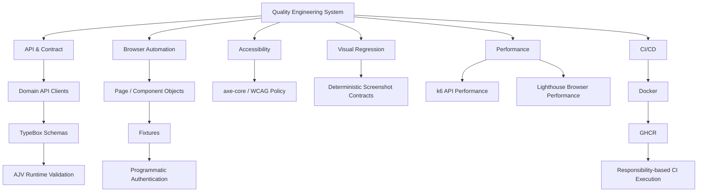

# Quality Engineering Showcase

> A Senior SDET / Quality Engineering case study demonstrating how I design and evolve maintainable, reproducible, and scalable quality engineering systems.

This showcase presents the architecture, implementation patterns, execution model, evidence, and roadmap of a production-oriented Quality Engineering system built around Playwright and TypeScript.

The emphasis is not only on automated test creation, but on **system design, execution ownership, deterministic setup, runtime validation, reproducibility, CI/CD, quality signals, diagnostics, and engineering decision-making**.

**Implemented today:** API, contract, UI, accessibility, visual regression, performance, Docker, cross-browser execution, and CI/CD.

**Roadmap:** Data & Cloud → AI-assisted QA → AI QA Platforms → Quality Engineering & Leadership → System Design, Security & Observability.

[View Full Framework Demo](#full-framework-demo) · [Explore Architecture](#architecture-at-a-glance) · [Framework Roadmap](#framework-roadmap)

---

## What This Project Demonstrates

The framework is developed as an **engineering system rather than a collection of automated tests**.

It currently demonstrates:

- API and browser automation with Playwright;
- schema-first API contracts with TypeBox and AJV runtime validation;
- Page Object and Component Object architecture;
- reusable fixtures and deterministic test-data factories;
- programmatic API and browser authentication;
- API-driven test setup and network mocking;
- Chromium, Firefox, and WebKit execution;
- automated accessibility testing with axe-core;
- deterministic visual regression testing;
- API performance testing with k6;
- browser performance testing with Lighthouse;
- reproducible Docker execution;
- GitHub Actions CI/CD with GHCR image reuse;
- actionable reports and failure diagnostics;
- documented engineering standards and architectural decisions.

The broader roadmap extends the system into **data validation, cloud foundations, AI-assisted Quality Engineering, AI-native testing platforms, QE strategy and leadership, system design, security, and observability**.

---

## Framework Capability Map

| Capability                         | Status         | Portfolio Evidence                   |
| ---------------------------------- | -------------- | ------------------------------------ |
| Enterprise automation architecture | ✅ Implemented | Architecture + selected source       |
| API automation                     | ✅ Implemented | Source + execution evidence          |
| Runtime contract validation        | ✅ Implemented | TypeBox/AJV example                  |
| UI automation                      | ✅ Implemented | Source + execution evidence          |
| Programmatic authentication        | ✅ Implemented | Architecture + selected example      |
| Deterministic test data            | ✅ Implemented | Factory/fixture example              |
| Network mocking                    | ✅ Implemented | Selected example                     |
| Cross-browser execution            | ✅ Implemented | Chromium / Firefox / WebKit evidence |
| Accessibility testing              | ✅ Implemented | Architecture + execution evidence    |
| Visual regression                  | ✅ Implemented | Architecture + visual evidence       |
| API performance testing            | ✅ Implemented | k6 execution evidence                |
| Browser performance testing        | ✅ Implemented | Lighthouse execution evidence        |
| Docker execution                   | ✅ Implemented | Architecture                         |
| GitHub Actions CI/CD               | ✅ Implemented | Pipeline architecture + evidence     |
| GHCR image reuse                   | ✅ Implemented | CI/CD architecture                   |
| SQL / advanced data validation     | ◇ Planned      | Framework roadmap                    |
| AWS / cloud foundations            | ◇ Planned      | Framework roadmap                    |
| AI-assisted QA workflow            | ◇ Planned      | Framework roadmap                    |
| AI QA platform evaluation          | ◇ Planned      | Framework roadmap                    |
| QE strategy & leadership           | ◇ Planned      | Framework roadmap                    |
| System design & security           | ◇ Planned      | Framework roadmap                    |
| Observability foundations          | ◇ Planned      | Framework roadmap                    |

> **Status rule:** a capability is marked as implemented only when it exists in the canonical private framework and can be supported by real implementation or execution evidence. Planned capabilities describe the roadmap and are not presented as completed work.

---

## Architecture at a Glance



The architecture separates **test behavior from reusable infrastructure** and assigns execution according to responsibility rather than multiplying every test across every runtime.

[Deep dive: Architecture](docs/ARCHITECTURE.md)

---

## Full Framework Demo

**Real execution evidence will be presented through a public-safe static framework demo.**

The demo will provide representative evidence for:

- API and contract execution;
- Chromium, Firefox, and WebKit UI execution;
- accessibility analysis;
- visual regression;
- k6 API performance;
- Lighthouse browser performance;
- CI/CD execution;
- Playwright diagnostics and reports.

The demo will be based on real framework execution rather than simulated or fabricated results.

**Full Framework Demo → _in preparation_**

---

## Selected Engineering Highlights

### Schema-First Runtime Contracts

Successful provider responses are validated at runtime before test code trusts their structure.

```text
HTTP response
    ↓
status assertion
    ↓
parse response
    ↓
AJV runtime validation
    ↓
typed business assertions
```

TypeBox defines provider contracts and their TypeScript relationship, while AJV verifies the actual runtime response.

### Deterministic Test Architecture

Test setup favors deterministic factories, reusable fixtures, and API-driven initialization where browser interaction is not the behavior under test.

```text
scenario
   ↓
fixture
   ↓
factory
   ↓
API / authentication setup
   ↓
deterministic application state
   ↓
behavior under test
```

### Explicit Execution Ownership

```text
API
→ browser independent
→ execute once

UI
→ browser behavior
→ Chromium / Firefox / WebKit

Accessibility
→ dedicated browser quality gate
→ Chromium

Visual regression
→ controlled rendering environment
→ canonical Docker/Linux execution

API performance
→ k6 runtime

Browser performance
→ Lighthouse + Chromium
```

This avoids redundant execution while preserving meaningful coverage.

### Reproducible Visual Testing

Visual regression uses deterministic state, native Playwright screenshot assertions, version-controlled approved baselines, and a canonical Docker/Linux rendering environment.

### Separated Performance Responsibilities

k6 owns API workload performance. Lighthouse owns browser-observed performance.

Authenticated Lighthouse scenarios reuse deterministic Playwright setup and evaluate shared browser-performance policy without duplicating business-state initialization.

### Build Once / Run Many

Playwright CI builds one Docker image per trusted workflow execution, publishes it to GHCR under the commit SHA, and reuses that exact image across downstream execution responsibilities.

[Deep dive: Engineering Decisions](docs/ENGINEERING_DECISIONS.md)

---

## CI/CD at a Glance

```text
quality
├── formatting
└── typecheck
        ↓
build image once
        ↓
push exact commit image to GHCR
        ↓
        ├── API
        ├── Accessibility
        ├── Visual Regression
        └── UI Browser Matrix
              ├── Chromium
              ├── Firefox
              └── WebKit
```

Performance execution has separate ownership:

```text
Performance Workflow
├── k6 API Performance
└── Browser Performance
    ├── Standalone Lighthouse
    └── Authenticated Playwright + Lighthouse
```

Performance testing is intentionally separated from the normal pull-request path because the current target is shared infrastructure rather than an isolated performance environment.

[Deep dive: CI/CD](docs/CI_CD.md)

---

## Selected Source

This showcase intentionally exposes a **curated set of representative implementation patterns**, rather than mirroring the complete canonical framework.

Selected source examples will cover:

- a domain API client;
- representative TypeBox contracts;
- AJV runtime validation;
- Page Object / Component Object design;
- fixture composition;
- a deterministic test-data factory;
- public-safe authentication architecture;
- network mocking;
- representative API and UI tests;
- accessibility patterns;
- visual regression patterns;
- performance-testing patterns.

Publication follows the private portfolio publication matrix. The goal is **architectural signal and engineering reasoning**, not source-code volume.

---

## Framework Roadmap

### ✅ Implemented

**Core Architecture**

- Playwright project architecture;
- fixtures;
- Page / Component Objects;
- configuration and environment handling;
- logging and reporting;
- deterministic test-data strategy.

**API & Contract**

- REST API testing;
- authentication;
- runtime response validation;
- TypeBox + AJV contracts;
- API/UI composition;
- network mocking.

**CI/CD & Containers**

- GitHub Actions;
- responsibility-based execution;
- browser matrix;
- Docker;
- GHCR image reuse;
- execution artifacts and diagnostics.

**Modern Quality Engineering**

- automated accessibility testing;
- visual regression;
- k6 API performance;
- Lighthouse browser performance.

### ◇ Next — Data & Cloud Foundations

- SQL;
- JOINs and aggregation;
- window functions;
- query analysis;
- AWS fundamentals;
- IAM;
- S3;
- CloudWatch;
- secrets management.

### ◇ Planned — AI-Assisted Quality Engineering

- GitHub Copilot;
- Cursor;
- ChatGPT-assisted QA workflows;
- AI-assisted test generation;
- AI-assisted debugging;
- prompt engineering;
- OpenAI API fundamentals.

### ◇ Planned — Modern AI QA Platforms

- AI-native testing platforms;
- self-healing approaches;
- regression automation;
- platform evaluation;
- proof-of-concept implementation.

### ◇ Planned — Quality Engineering & Leadership

- test strategy;
- risk-based testing;
- test pyramid;
- shift-left / shift-right;
- quality metrics;
- flaky-test analysis;
- defect leakage;
- MTTD / MTTR;
- mentoring;
- stakeholder management;
- technical communication.

### ◇ Planned — System Design, Security & Observability

- QA system design;
- microservices testing;
- distributed-system testing concepts;
- OWASP Top 10 fundamentals;
- observability;
- logs;
- Grafana / Kibana fundamentals.

[Deep dive: Framework Roadmap](docs/ROADMAP.md)

---

## Deep Technical Documentation

The public showcase will provide portfolio-oriented technical documentation derived from the canonical framework and filtered through the publication matrix:

- [Architecture](docs/ARCHITECTURE.md)
- [CI/CD](docs/CI_CD.md)
- [Engineering Decisions](docs/ENGINEERING_DECISIONS.md)
- [Selected Testing Standards](docs/TESTING_STANDARDS.md)
- [Framework Roadmap](docs/ROADMAP.md)

These documents are curated public representations rather than mirrors of the complete private engineering documentation.

---

## Technology Stack

### Implemented

**Playwright · TypeScript · Node.js · TypeBox · AJV · axe-core · Docker · GitHub Actions · GHCR · k6 · Lighthouse**

### Roadmap

**SQL · AWS · AI-assisted QA tooling · AI QA platforms · security and observability tooling**

Roadmap technologies are listed as planned areas and do not represent completed framework integrations.

---

## About This Showcase

This repository is a **curated public Quality Engineering portfolio and engineering case study**.

The complete framework implementation is maintained separately as the canonical source of truth.

This showcase intentionally combines:

```text
selected implementation
        +
architecture
        +
engineering decisions
        +
real execution evidence
        +
future engineering roadmap
```

rather than publishing a second independently maintained copy of the complete framework.

Every public claim and asset must be supported by either:

- the verified canonical implementation, for implemented capabilities; or
- the framework roadmap, for explicitly planned capabilities.

Selected source and execution evidence are published only after public-safety review.
